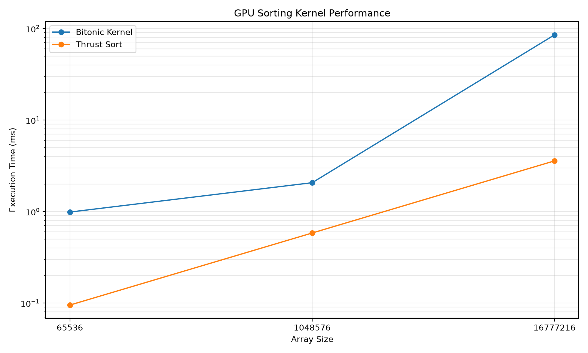
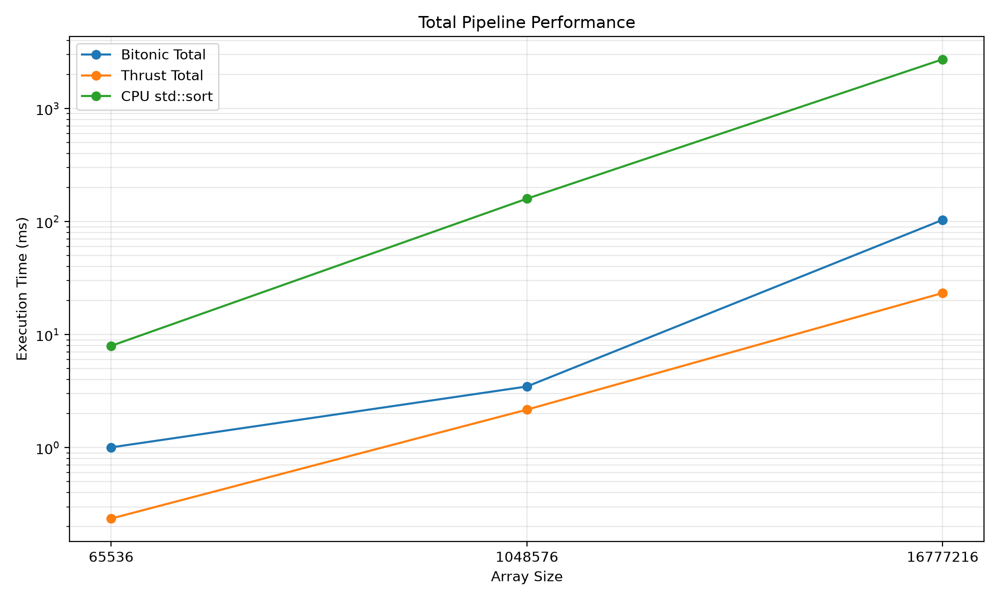
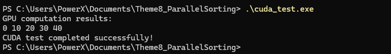
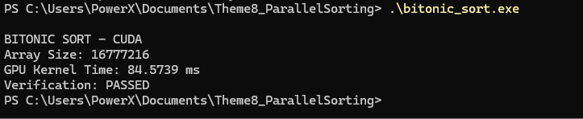
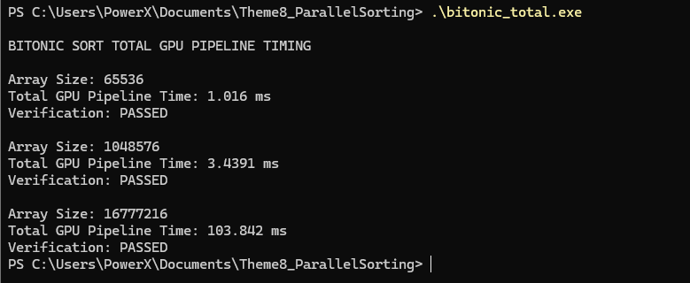

# Theme 8 – Parallel Sorting on the GPU

<p align="center">
  <b>GPU-Accelerated Parallel Sorting Using NVIDIA CUDA</b>
</p>

<p align="center">
  
  
  
  
  
</p>

## 1. Project Overview

This project implements and evaluates GPU-based parallel sorting using NVIDIA CUDA.

Sorting is a fundamental operation in computer science. Traditional CPU sorting executes operations primarily on the CPU, whereas GPU-based sorting exploits parallel execution to process multiple operations simultaneously.

This project compares three sorting approaches:

1. **Custom Bitonic Sort:** A parallel sorting algorithm implemented using CUDA kernels.
2. **NVIDIA Thrust Sort:** GPU sorting using NVIDIA's optimized Thrust library.
3. **CPU Sort:** Standard C++ `std::sort()` implementation.

The objective is to study GPU sorting performance against CPU sorting and understand the impact of kernel execution and data transfer overhead on overall performance.

## 2. Project Objectives

- Implement a custom Bitonic Sorting algorithm using CUDA.
- Explore GPU sorting using NVIDIA Thrust.
- Establish CPU sorting performance using `std::sort()`.
- Compare sorting performance across different input sizes.
- Measure GPU kernel execution time.
- Measure complete GPU pipeline execution time.
- Analyze the impact of host-to-device and device-to-host data transfers.
- Evaluate the performance and scalability of GPU-based sorting.

## 3. Hardware and Software Requirements

| Component | Specification |
|---|---|
| GPU | NVIDIA GeForce RTX 5060 Ti |
| CUDA Toolkit | 13.4 |
| Compiler | NVIDIA NVCC |
| Development Tools | Visual Studio Build Tools |
| Programming Languages | C++ and CUDA C++ |
| GPU Library | NVIDIA Thrust |
| Operating System | Windows |

## 4. Technologies Used

| Technology | Application |
|---|---|
| CUDA C++ | GPU parallel programming |
| NVIDIA Thrust | Optimized GPU sorting |
| C++ STL | CPU sorting baseline |
| CUDA Runtime API | GPU memory and execution management |
| Python | Performance graph generation |
| Matplotlib | Data visualization |
| Git and GitHub | Version control |

## 5. Sorting Algorithms Implemented

### 5.1 Custom CUDA Bitonic Sort

Bitonic Sort is a comparison-based parallel sorting algorithm that is suitable for parallel execution.

It works by repeatedly comparing and exchanging elements at different positions to create a sorted sequence.

**Working principle:**

1. Generate a bitonic sequence.
2. Divide the sequence into ascending and descending subsequences.
3. Perform parallel compare-and-exchange operations.
4. Reduce the comparison distance in successive stages.
5. Repeat until the complete sequence is sorted.

The implementation uses CUDA threads to execute independent comparison operations in parallel.

**Complexity:**

- Sequential work: O(n log² n)
- Parallel depth: O(log² n)

### 5.2 NVIDIA Thrust Sort

NVIDIA Thrust is a C++ parallel algorithms library that provides high-level GPU programming functionality.

This project uses `thrust::sort()` to perform GPU-based sorting.

**Implementation features:**

- Uses `thrust::device_vector` for GPU memory.
- Uses `thrust::sort()` for sorting.
- Measures GPU sorting time using CUDA events.
- Compares the sorted output against CPU sorting.

Thrust provides an optimized library implementation without requiring manual implementation of the sorting algorithm.

### 5.3 CPU Sorting Using std::sort()

The standard C++ sorting function `std::sort()` is used as the CPU baseline.

It provides a reference for evaluating the performance of GPU-based sorting approaches.

## 6. GPU Pipeline Implementations

In addition to measuring sorting execution time, two implementations evaluate the complete GPU sorting pipeline.

**Bitonic Total Pipeline**

Measures the complete execution of the custom Bitonic sorting approach.

**Thrust Total Pipeline**

Measures the complete execution of NVIDIA Thrust sorting.

The total pipeline measurement includes:

1. Host-to-device data transfer.
2. GPU sorting execution.
3. Device-to-host data transfer.

GPU memory allocation and warm-up operations are performed outside the timed region.

This allows us to distinguish between sorting execution time and the time required to transfer data between CPU and GPU memory.

## 7. Experimental Methodology

Three input sizes are evaluated.

| Experiment | Array Size |
|---|---:|
| Small | 65,536 |
| Medium | 1,048,576 |
| Large | 16,777,216 |

**Input generation:**

- Input data is generated using the C++ random number generator.
- A fixed random seed of `42` is used for reproducibility.
- Random integer values are generated between 0 and 1,000,000.
- CPU `std::sort()` is used as the reference for correctness verification.
- All reported execution times are measured in milliseconds.

**Performance measurements:**

The experiment records:

- Bitonic kernel execution time.
- Bitonic total pipeline time.
- Thrust sorting execution time.
- Thrust total pipeline time.
- CPU sorting execution time.

## 8. Experimental Results

All execution times are reported in milliseconds.

| Input Size | Bitonic Kernel | Bitonic Total | Thrust Sort | Thrust Total | CPU Sort |
|---:|---:|---:|---:|---:|---:|
| 65,536 | 0.986944 | 1.0062 | 0.095008 | 0.2361 | 7.9595 |
| 1,048,576 | 2.06643 | 3.4772 | 0.582784 | 2.1698 | 159.418 |
| 16,777,216 | 85.2817 | 103.535 | 3.57914 | 23.3512 | 2726.66 |

**Correctness Verification:** All three tested array sizes passed correctness verification in the recorded experiments.

## 9. Performance Visualization

The following graphs illustrate the performance differences between the GPU sorting implementations.

### 9.1 GPU Kernel Performance

This graph compares the sorting execution times of the custom Bitonic implementation and NVIDIA Thrust, excluding the complete data transfer pipeline.



### 9.2 Total Pipeline Performance

This graph compares the complete GPU sorting pipeline, including host-to-device transfer, sorting execution, and device-to-host transfer.



## 10. Execution Screenshots

The following screenshots provide experimental evidence of the CUDA implementations and their execution results.

### 10.1 CUDA Environment Test

Verifies CUDA environment availability and basic execution.



### 10.2 Custom Bitonic Sort

Shows the execution of the custom CUDA-based Bitonic Sorting algorithm.



### 10.3 Thrust vs CPU Sorting

Shows the comparison between NVIDIA Thrust GPU sorting and CPU `std::sort()`.


### 10.4 Bitonic Total Pipeline

Shows the performance measurement of the complete Bitonic sorting pipeline.



### 10.5 Thrust Total Pipeline

Shows the performance measurement of the complete NVIDIA Thrust sorting pipeline.


## 11. Performance Analysis

### 11.1 Bitonic Sort vs Thrust Sort

The experimental results show that NVIDIA Thrust achieved lower GPU sorting execution times than the custom Bitonic implementation across all three tested input sizes.

The difference can be attributed to factors such as:

- Optimizations in the Thrust library.
- Multiple kernel launches required by the custom Bitonic implementation.
- Differences in memory access patterns.
- GPU execution and synchronization overhead.

### 11.2 Kernel Execution Time vs Total Pipeline Time

Kernel execution time measures the GPU sorting operation itself.

Total pipeline time includes:

- Host-to-device transfer.
- GPU sorting.
- Device-to-host transfer.

The total pipeline time is therefore higher than kernel-only execution time.

For example, for an input size of 16,777,216:

| Implementation | Execution Time |
|---|---:|
| Bitonic Kernel | 85.2817 ms |
| Bitonic Total | 103.535 ms |
| Thrust Sort | 3.57914 ms |
| Thrust Total | 23.3512 ms |

This demonstrates why evaluating only kernel execution time does not provide the complete picture of GPU application performance.

### 11.3 GPU vs CPU Performance

NVIDIA Thrust achieved lower recorded execution times than CPU `std::sort()` for all three tested input sizes.

For the largest input:

- Thrust total pipeline time: 23.3512 ms
- CPU sorting time: 2726.66 ms

This highlights the potential performance benefits of GPU parallelism for the tested sorting workloads.

## 12. Key Observations

1. GPU-based sorting achieved significantly lower recorded execution times than CPU sorting in the tested experiments.
2. NVIDIA Thrust outperformed the custom Bitonic implementation in both sorting execution and total pipeline measurements.
3. Kernel-only timing and total pipeline timing provide different perspectives on GPU performance.
4. Data transfer overhead contributes to the total execution time.
5. The performance difference between GPU and CPU implementations becomes more pronounced as input size increases.
6. Optimized GPU libraries can provide better performance than a custom implementation.

## 13. Limitations

- Results depend on the GPU architecture and execution environment.
- GPU memory transfer overhead affects complete pipeline performance.
- The custom Bitonic implementation requires multiple comparison stages and kernel launches.
- Only three input sizes are evaluated.
- Additional experiments are required to evaluate different input distributions and GPU architectures.
- The recorded results represent the tested configuration and should not be generalized to every GPU or workload.

## 14. Future Enhancements

- Optimize the custom Bitonic Sort CUDA implementation.
- Explore shared memory optimization.
- Investigate memory coalescing and efficient memory access.
- Evaluate additional parallel sorting algorithms.
- Perform repeated benchmark runs and calculate average execution times.
- Test different input distributions.
- Evaluate performance across additional GPU architectures.
- Investigate the relationship between kernel execution time and end-to-end application performance.

## 15. Project Structure

```text
Parallel-Sorting-/
│
├── Graphs/
│   ├── gpu_kernel_performance.png
│   └── total_pipeline_performance.png
│
├── Screenshots/
│   ├── 01_CUDA_Test.png
│   ├── 02_Bitonic_Sort.png
│   ├── 03_Thrust_vs_CPU.png
│   ├── 04_Bitonic_Total_Pipeline.png
│   └── 05_Thrust_Total_Pipeline.png
│
├── cuda_test.cu
├── bitonic_sort.cu
├── bitonic_total.cu
├── thrust_sort.cu
├── thrust_total.cu
│
├── generate_graphs.py
├── results.csv
└── README.md
```

## 16. Compilation and Execution

### Prerequisites

Ensure that the following are installed:

- NVIDIA CUDA Toolkit 13.4
- NVIDIA GPU with CUDA support
- Visual Studio Build Tools
- NVIDIA NVCC compiler

Open PowerShell in the project directory.

### 16.1 CUDA Environment Test

```powershell
nvcc cuda_test.cu -o cuda_test.exe
.\cuda_test.exe
```

### 16.2 Custom Bitonic Sort

```powershell
nvcc bitonic_sort.cu -o bitonic_sort.exe
.\bitonic_sort.exe
```

### 16.3 Bitonic Total Pipeline

```powershell
nvcc bitonic_total.cu -o bitonic_total.exe
.\bitonic_total.exe
```

### 16.4 NVIDIA Thrust Sort

```powershell
nvcc thrust_sort.cu -o thrust_sort.exe
.\thrust_sort.exe
```

### 16.5 Thrust Total Pipeline

```powershell
nvcc thrust_total.cu -o thrust_total.exe
.\thrust_total.exe
```

### 16.6 Generate Performance Graphs

```powershell
python generate_graphs.py
```

## 17. Conclusion

This project demonstrates the implementation and evaluation of parallel sorting algorithms using NVIDIA CUDA.

By comparing a custom Bitonic Sort implementation, NVIDIA Thrust, and CPU `std::sort()`, the experiment highlights the differences between custom GPU algorithms, optimized GPU libraries, and conventional CPU sorting.

The recorded experimental results show that NVIDIA Thrust achieves lower execution times than both the custom Bitonic implementation and CPU sorting for the tested input sizes.

The project also demonstrates the importance of considering memory transfer overhead when evaluating GPU application performance.

Overall, this project provides practical experience in:

- CUDA programming.
- Parallel algorithm implementation.
- GPU memory management.
- Kernel execution and synchronization.
- Performance benchmarking.
- Experimental analysis and visualization.

---

<p align="center">
  <b>Theme 8 – Parallel Computing Project</b>
  <br>
  Developed using C++, CUDA and NVIDIA GPU Computing.
</p>
