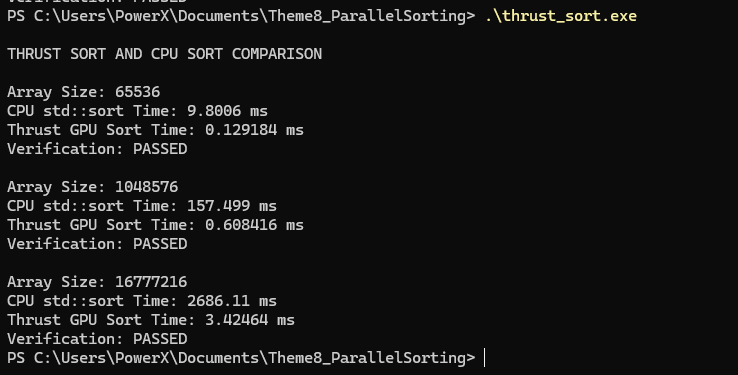
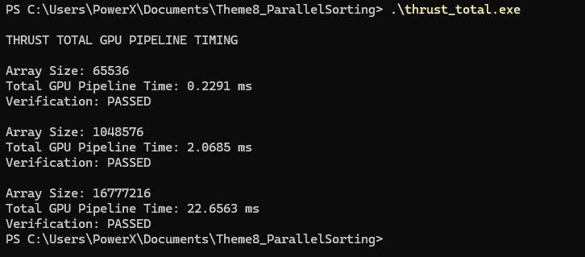

# Theme 8 – Parallel Sorting on the GPU

## Project Overview

This project implements and evaluates GPU-based parallel sorting using CUDA.

The experiment compares three sorting approaches:

1. **Custom Bitonic Sort** – A parallel sorting algorithm implemented using CUDA kernels.
2. **NVIDIA Thrust Sort** – GPU sorting using NVIDIA's optimized Thrust library.
3. **CPU Sort** – Standard C++ `std::sort` implementation.

The objective is to study the performance of GPU-based sorting against CPU sorting and understand the impact of data transfers and kernel execution on overall performance.

## Hardware and Software Requirements

| Component | Specification |
|---|---|
| GPU | NVIDIA GeForce RTX 5060 Ti |
| CUDA Toolkit | 13.4 |
| Compiler | NVIDIA NVCC |
| Development Tools | Visual Studio Build Tools |
| Programming Languages | C++ and CUDA C++ |

## Project Implementations

### 1. CUDA Bitonic Sort

A custom implementation of the Bitonic Sorting algorithm using CUDA.

- Uses parallel compare-and-exchange operations.
- Executes multiple CUDA kernel launches.
- Measures GPU kernel execution time separately.
- Verifies the sorted output against CPU `std::sort`.

### 2. NVIDIA Thrust Sort

Uses NVIDIA's Thrust library to perform GPU-based sorting.

- Uses `thrust::device_vector` for GPU memory.
- Uses `thrust::sort()` for sorting.
- Measures GPU sorting time using CUDA events.
- Compares the output against CPU sorting.

### 3. CPU Sorting

Uses the standard C++ sorting algorithm:

`std::sort()`

This provides a CPU baseline for comparing GPU sorting performance.

### 4. Total GPU Pipeline Timing

Two additional implementations measure the complete GPU sorting pipeline.

The measured operations include:

1. Host-to-GPU data transfer.
2. GPU sorting execution.
3. GPU-to-host data transfer.

GPU memory allocation and warm-up operations are performed outside the timed region.

This provides a more complete comparison than measuring sorting execution alone.

## Experimental Methodology

Three input sizes are evaluated:

| Experiment | Array Size |
|---|---:|
| Small | 65,536 |
| Medium | 1,048,576 |
| Large | 16,777,216 |

- Input data is generated using the C++ random number generator.
- A fixed random seed (`42`) is used for reproducibility.
- Random integer values are generated between 0 and 1,000,000.
- CPU `std::sort()` is used as the reference for correctness verification.
- All reported timings are in milliseconds.

## Experimental Results

All timings are in milliseconds.

| Array Size | Bitonic Kernel | Bitonic Total | Thrust Sort | Thrust Total | CPU Sort |
|---:|---:|---:|---:|---:|---:|
| 65,536 | 0.986944 | 1.0062 | 0.095008 | 0.2361 | 7.9595 |
| 1,048,576 | 2.06643 | 3.4772 | 0.582784 | 2.1698 | 159.418 |
| 16,777,216 | 85.2817 | 103.535 | 3.57914 | 23.3512 | 2726.66 |

**Correctness Verification:** All three array sizes are marked PASSED in the recorded experimental results.

## Performance Analysis

### Bitonic Sort vs Thrust Sort

- Thrust achieved lower GPU sorting times than the custom Bitonic implementation in all three recorded experiments.
- The custom Bitonic implementation requires multiple kernel launches for its compare-and-exchange stages.
- Thrust provides an optimized GPU sorting implementation through its library.

### Kernel Time vs Total Pipeline Time

- Kernel-only timing measures GPU sorting execution.
- Total pipeline timing includes host-to-device transfer, sorting, and device-to-host transfer.
- Including data transfers increases the measured execution time.

### GPU vs CPU Performance

- GPU-based Thrust sorting was faster than CPU `std::sort()` for all three tested array sizes in the recorded results.
- For the largest array, Thrust total pipeline time was 23.3512 ms, compared with 2726.66 ms for CPU sorting.

These results demonstrate the potential benefits of GPU parallelism for large-scale sorting workloads.

## Screenshots and Experimental Evidence

### 1. CUDA Environment Test


### 2. Bitonic Sort Execution


### 3. Thrust vs CPU Sorting



### 4. Bitonic Total Pipeline Timing


### 5. Thrust Total Pipeline Timing




## Performance Graphs

### GPU Kernel Performance


### Total Pipeline Performance


## Project Structure

```text
Theme8_ParallelSorting/
│
├── README.md
├── results.csv
│
├── cuda_test.cu
├── bitonic_sort.cu
├── bitonic_total.cu
├── thrust_sort.cu
├── thrust_total.cu
│
└── Screenshots/
    ├── 01_CUDA_Test.png
    ├── 02_Bitonic_Sort.png
    ├── 03_Thrust_vs_CPU.png
    ├── 04_Bitonic_Total_Pipeline.png
    └── 05_Thrust_Total_Pipeline.png
```

## Compilation and Execution

Compile the CUDA programs using NVIDIA NVCC.

### CUDA Test

```bash
nvcc cuda_test.cu -o cuda_test.exe
.\cuda_test.exe
```

### Bitonic Sort

```bash
nvcc bitonic_sort.cu -o bitonic_sort.exe
.\bitonic_sort.exe
```

### Bitonic Total Pipeline

```bash
nvcc bitonic_total.cu -o bitonic_total.exe
.\bitonic_total.exe
```

### Thrust Sort

```bash
nvcc thrust_sort.cu -o thrust_sort.exe
.\thrust_sort.exe
```

### Thrust Total Pipeline

```bash
nvcc thrust_total.cu -o thrust_total.exe
.\thrust_total.exe
```

## Conclusion

This project demonstrates the application of GPU parallelism to sorting operations using CUDA.

The experimental comparison highlights the difference between a custom parallel sorting algorithm, an optimized GPU library implementation, and a conventional CPU sorting algorithm.

The results show that NVIDIA Thrust Sort provides better sorting performance than the custom Bitonic implementation in these experiments. They also demonstrate that data transfer overhead contributes to total GPU pipeline execution time.

Overall, the experiment provides practical insight into CUDA kernel execution, GPU memory transfers, parallel algorithms, and performance evaluation.
